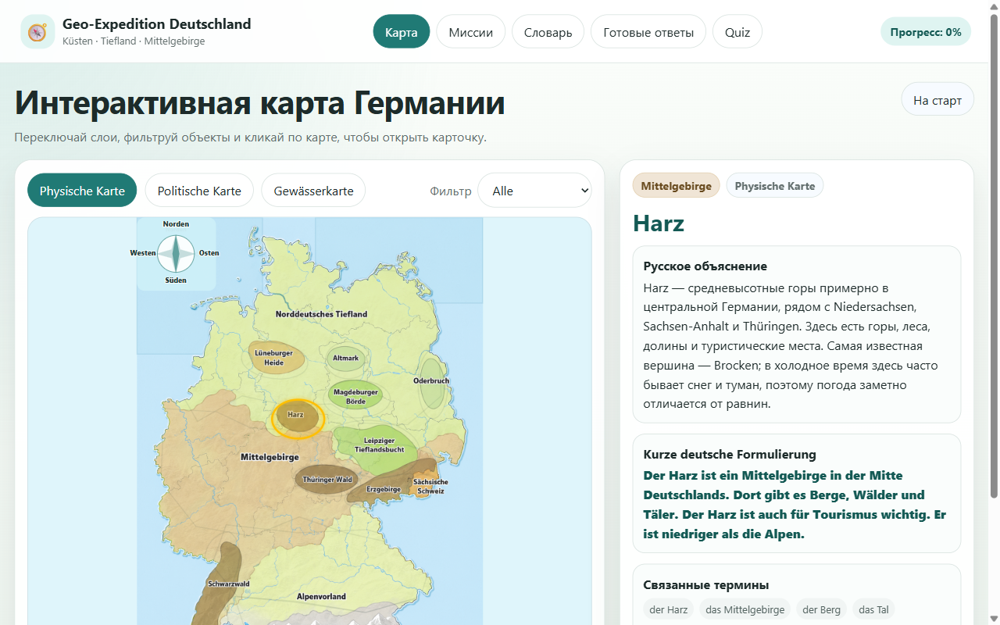

# Geo-Expedition Deutschland

**[▶ Open in the browser](https://gluonmaster.github.io/geo-expedition-deutschland/)**

A geography learning app about Germany for grade 5. Students explore interactive maps of the landscapes, federal states and rivers, then go on short missions that test what they've learned. Like [Chemie-Eroberung](https://github.com/gluonMaster/chemie-eroberung), it is made for Russian-speaking students at German schools: the explanations are in Russian, and the place names, terms and model answers are in German.



## Features

- Three map layers: physical geography, federal states and waterways.
- Info cards for landscapes and other map features and for all 16 federal states, each with a Russian explanation and a short German description.
- 62 tasks across five missions (orientation, coasts, lowlands, uplands and a final review) in five formats: pick on the map, multiple choice, matching, ordering and three-step questions.
- Missions are drawn at random from the task pool, with hints, explanations, a glossary and model answers.
- Progress and earlier mistakes are saved in the browser.

## Running it locally

Open [index.html](index.html). There is nothing to install or build, and the app needs no backend, map service or API key. To serve it locally instead:

```sh
python -m http.server 8000 --bind 127.0.0.1
```

and open `http://127.0.0.1:8000/`. The layout is made for laptops and tablets.

## Source layout

| Path | Purpose |
| --- | --- |
| [index.html](index.html) | App shell and the clickable SVG map regions |
| [js/app.js](js/app.js) | Navigation, tasks, missions and progress |
| [js/data.js](js/data.js) | Learning content, map objects, glossary and tasks |
| [css/styles.css](css/styles.css) | Layout and map styling |
| `assets/map-*-schematic.png` | Map backgrounds |

Progress is stored in `localStorage` and never leaves the browser. The map backgrounds were generated with GPT and simplified for teaching; they are illustrations, not exact cartography.

## Credits and license

Made by Dr. Konstantin S. Shakun with the help of AI coding agents. The code is available under the [MIT License](LICENSE).
